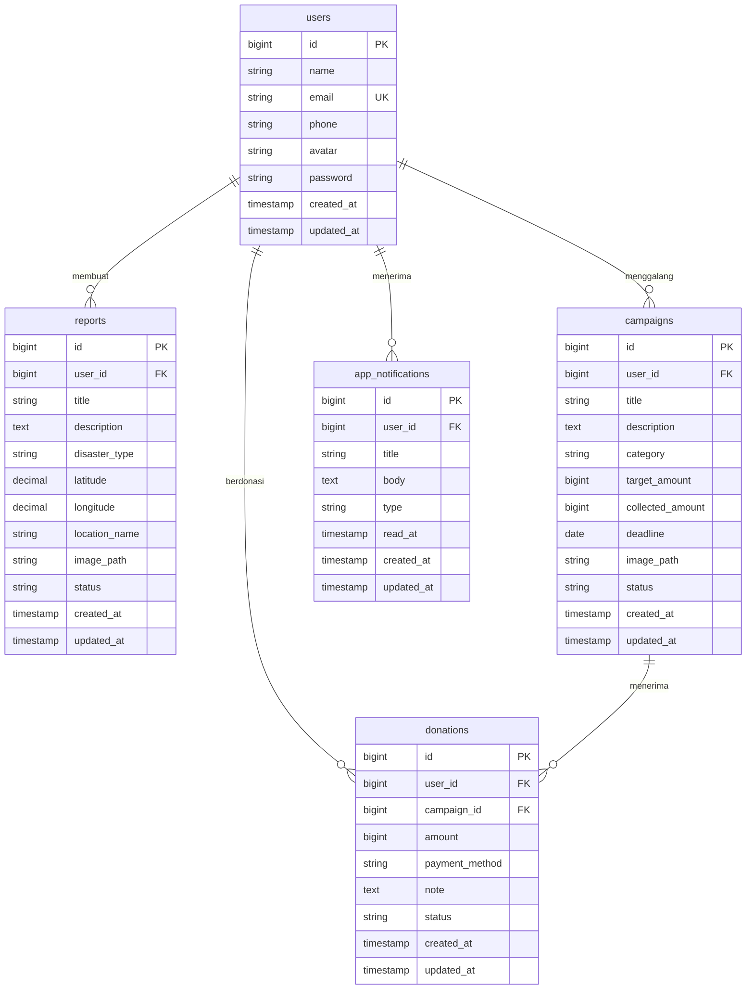

# Database SiagaNusa

Dokumentasi skema dan diagram relasi entitas (*Entity Relationship Diagram*) yang digunakan oleh aplikasi **SiagaNusa** (`Backend/database/migrations/`).

---

## 1. Entity Relationship Diagram (ERD)

---

## 2. Daftar Tabel

| Tabel | Deskripsi | Relasi |
| :--- | :--- | :--- |
| `users` | Data pengguna aplikasi (warga/relawan) | `1:N` ke `reports`, `campaigns`, `donations`, `app_notifications` |
| `personal_access_tokens` | Token autentikasi API (Laravel Sanctum) | Polimorfik ke `users` |
| `reports` | Laporan kejadian bencana dari masyarakat | `N:1` ke `users` |
| `campaigns` | Kampanye penggalangan dana bencana | `N:1` ke `users`, `1:N` ke `donations` |
| `donations` | Transaksi donasi pengguna ke kampanye | `N:1` ke `users` dan `campaigns` |
| `app_notifications` | Notifikasi peringatan dini & info aplikasi | `N:1` ke `users` (nullable untuk broadcast) |

> File SQL lengkap tersedia di [`schema.sql`](./schema.sql).
